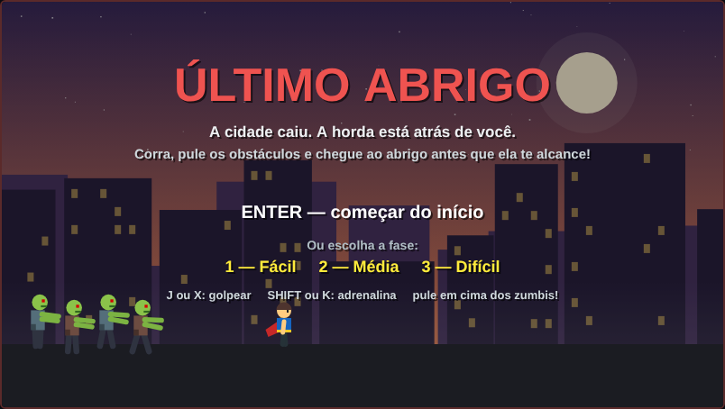
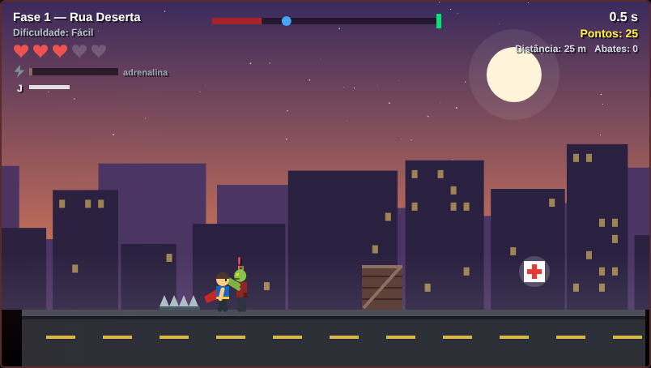
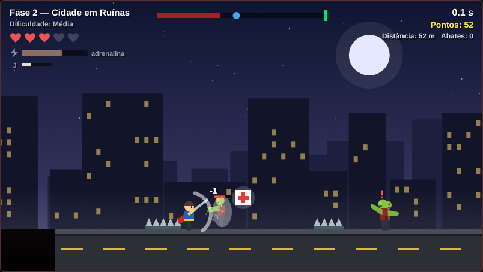
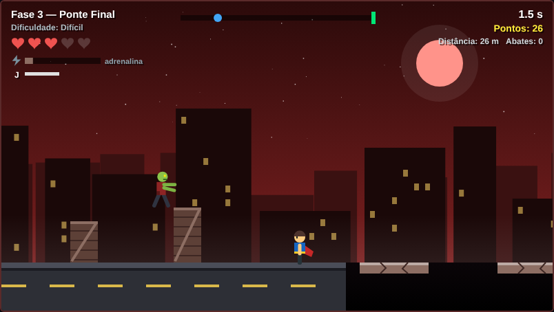
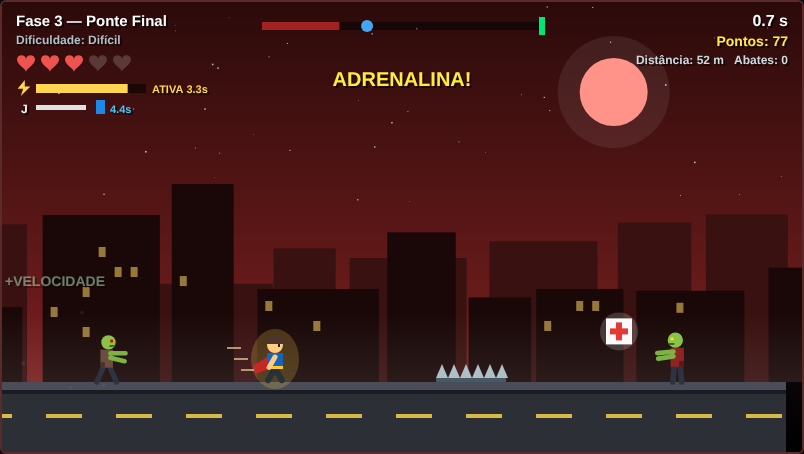

# Último Abrigo

Jogo de plataforma 2D em **JavaScript puro com `<canvas>`**, feito para a disciplina de **Programação Orientada a Objetos (NI1)**.
Um herói foge de uma horda de zumbis e precisa chegar ao abrigo no fim de cada fase. O jogo não usa nenhuma biblioteca e todos os gráficos são desenhados por código.



## Sobre o jogo

A cidade caiu e a horda avança sem parar atrás de você. Corra, pule buracos e barricadas, desvie do arame farpado e enfrente os zumbis com uma barra de ferro até alcançar o abrigo. A horda é o relógio do jogo: quem para ou erra muito é alcançado.

- **3 fases**, da fácil à difícil: Rua Deserta, Cidade em Ruínas e Ponte Final.
- **Zumbis caçadores com inteligência artificial**: veem o herói, perseguem, calculam e executam saltos sobre barricadas e buracos, e param na beirada quando o salto é impossível.
- **Combate corpo a corpo**: golpe com a barra de ferro, com recarga; pisar em cima de um zumbi também o elimina.
- **Itens**: kit médico (+1 vida) e energético (+30% de velocidade por 5 segundos).
- **Adrenalina**: com a barra cheia, +45% de velocidade e golpes mais rápidos por 4 segundos.
- **Dificuldade progressiva**: quanto mais você avança, mais zumbis aparecem, mais rápidos e resistentes (sempre com um limite).
- **Pontuação** por abates, itens e distância percorrida.

| Fase 1 · Rua Deserta | Combate com a barra de ferro |
| --- | --- |
|  |  |
| **Zumbi saltando uma barricada** | **Adrenalina ativa** |
|  |  |

## Controles

| Ação | Teclas |
| --- | --- |
| Correr | ← → ou A D |
| Pular | Espaço, ↑ ou W |
| Golpear com a barra de ferro | J ou X |
| Ativar a adrenalina (barra cheia) | Shift ou K |
| Pausar | P |
| Reiniciar a fase | R |
| Voltar ao menu | Esc |

No menu, **Enter** começa da fase 1 e **1**, **2** ou **3** abrem cada fase direto.

## Como instalar e jogar

O jogo não precisa de instalação, servidor nem internet: basta um navegador atualizado (Chrome, Edge ou Firefox).

### Opção 1 — Baixar o ZIP

1. Nesta página do repositório, clique no botão verde **Code** → **Download ZIP**.
2. Extraia o arquivo baixado. Abrir o `index.html` de dentro do ZIP, sem extrair, não carrega os scripts.
3. Entre na pasta extraída e dê dois cliques no `index.html`.

### Opção 2 — Clonar com Git

```bash
git clone https://github.com/[usuario]/[repositorio].git
cd [repositorio]
```

Depois, abra o `index.html` no navegador (dois cliques, ou arraste o arquivo para uma aba).

### Opção 3 — Jogar online pelo GitHub Pages

Para publicar o jogo e jogar por um link, sem baixar nada:

1. No repositório, vá em **Settings** → **Pages**.
2. Em **Build and deployment**, escolha **Source: Deploy from a branch**.
3. Em **Branch**, escolha `main` e a pasta `/ (root)`, e clique em **Save**.
4. Espere cerca de um minuto e atualize a página. O link aparece no topo, no formato `https://[usuario].github.io/[repositorio]/`.

## Como rodar os testes automáticos (opcional)

São 39 testes que abrem o jogo num navegador e conferem a física, os zumbis, o combate, os itens, o reinício e a ausência de erros. Um robô também joga as 3 fases até o abrigo.

1. Instale o [Node.js](https://nodejs.org) (versão LTS).
2. Abra um terminal na pasta do projeto e rode:

```bash
npm install playwright
npx playwright install chromium
node testes/teste.js .
```

A última linha deve mostrar `TOTAL: 39/39 passaram`. A pasta `node_modules` criada pelo `npm install` já está no `.gitignore` e não deve ser enviada ao GitHub.

## Problemas comuns

| Problema | Como resolver |
| --- | --- |
| A tela do jogo fica preta | Extraia o ZIP antes de abrir. Se continuar, aperte **F12**, abra a aba **Console** e veja a mensagem de erro |
| `NomeDaClasse is not defined` no Console | No `index.html`, o `<script>` de uma classe filha precisa vir depois do da classe pai |
| As teclas não respondem | Clique uma vez em cima do jogo para dar foco à página |
| Mudei o código e nada mudou | Salve o arquivo e recarregue com **Ctrl+F5** |
| `Cannot find module 'playwright'` | Rode o `npm install playwright` dentro da pasta do projeto |

## Programação Orientada a Objetos

O código está em `js/`, **uma classe por arquivo**, todo comentado em português.

| Conceito | Onde aparece |
| --- | --- |
| Classes e objetos | 27 classes; os objetos de cada fase são criados com `new` em `Fase.js` |
| Herança | `Jogador`, `Horda`, `Abrigo`, `Item` e `Obstaculo` herdam de `Entidade`; `Chao`, `Barricada`, `PlataformaMovel`, `PlataformaQuebradica`, `Espinho`, `ZumbiPatrulha` e `ZumbiCacador` herdam de `Obstaculo`; `Remedio` e `Energetico` herdam de `Item`; as três fases herdam de `Fase` |
| Polimorfismo | O `Jogo` chama `aoColidir()`, `receberGolpe()` e `atualizar()` em todos os obstáculos sem saber o tipo, e cada classe responde do seu jeito; cada fase sobrescreve `construir()` (Template Method) |
| Encapsulamento | Cada classe cuida do próprio estado; o Jogo só pede (`jogador.receberDano()`) |
| Getters e métodos estáticos | `Entidade.direita`, `Jogador.multVelocidade`; `Desenho.zumbi()`, `Fisica.impulsoParaAlcancar()` |
| Composição | O `Jogo` tem uma `Tela`, um `Hud`, um `Diretor` e um `Efeitos` |
| Máquina de estados | `ZumbiCacador`: IDLE → CHASE → APPROACH_OBSTACLE → JUMP / ATTACK / STUNNED → DEAD |

```
Entidade
 ├── Jogador
 ├── Horda
 ├── Abrigo
 ├── Item ── Remedio, Energetico
 └── Obstaculo
      ├── Chao, Barricada, Espinho
      ├── PlataformaMovel, PlataformaQuebradica
      └── ZumbiPatrulha, ZumbiCacador

Fase ── FaseFacil, FaseMedia, FaseDificil
```

## Estrutura do projeto

```
├── index.html          página do jogo (abra esta)
├── estilo.css          estilo da página
├── js/                 27 classes, uma por arquivo
├── testes/teste.js     testes automáticos (Playwright)
├── evidencias/         prints usados na documentação
├── docs/imagens/       imagens deste README
├── antes/v2/           versão anterior, para comparar antes e depois
└── DOCUMENTACAO.md     documentação completa: prompts, bugs, correções e comparação entre IAs
```

## Ferramentas de IA

O desenvolvimento usou duas ferramentas de IA, como pede a avaliação: **Claude** (Anthropic), para gerar e testar o código, e **ChatGPT-5.5** (OpenAI), como revisor independente. Os prompts, os resultados, os bugs encontrados e a comparação entre as duas estão no [DOCUMENTACAO.md](DOCUMENTACAO.md).

## Equipe

| Integrantes | 
| --- |
| Enzo Lemos | 
| Igor Araújo | 
| Mateus Lima | 
| Daniel Câmara | 

## Créditos

- Todos os gráficos são desenhados por código, sem imagens ou assets de terceiros.
- Código-base e testes feitos com auxílio de IA (ver [DOCUMENTACAO.md](DOCUMENTACAO.md)).
